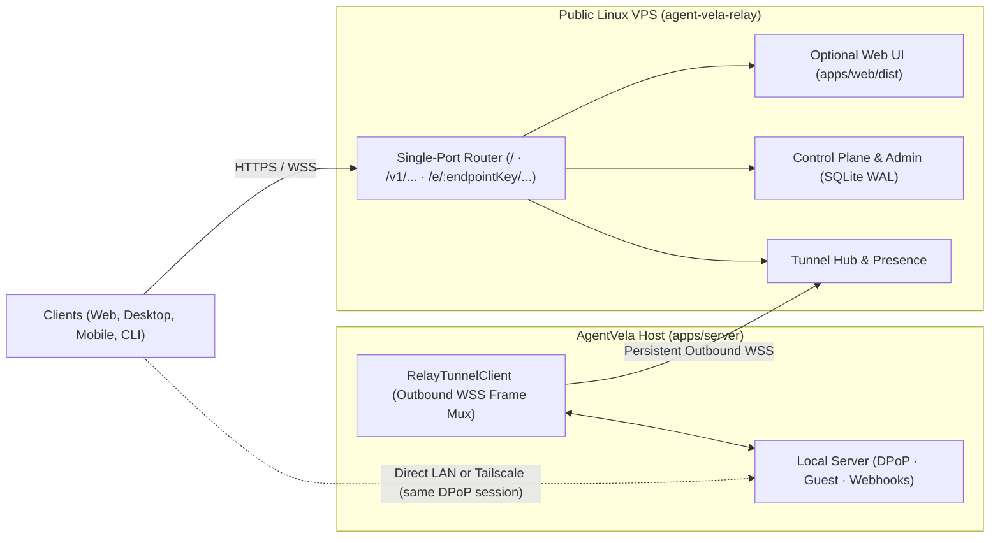
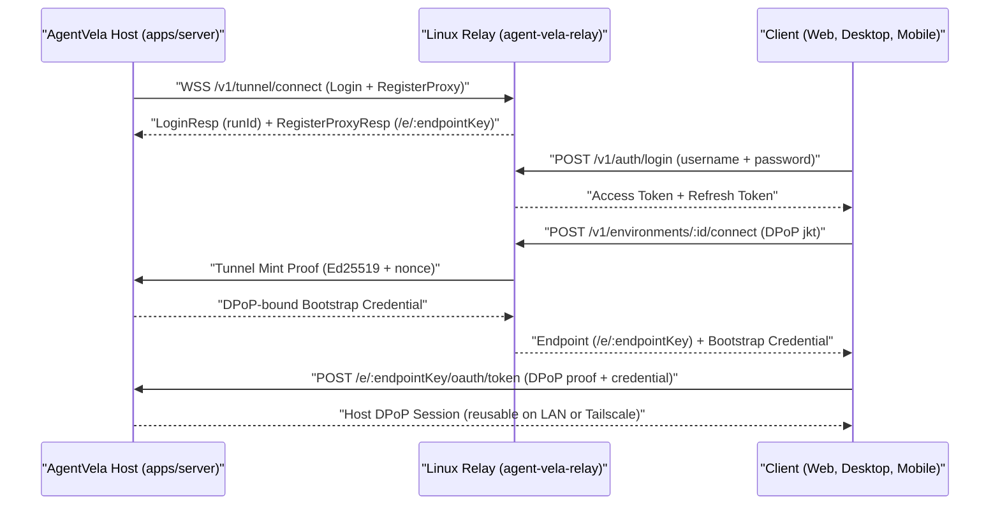

# Self-Hosted Relay (`agent-vela-relay`)

AgentVela uses `agent-vela-relay` (`apps/relay`) for remote multi-device management without third-party auth providers, external cloud databases, or `cloudflared` child binaries. A single Node.js + Effect service backed by SQLite WAL ([`nodeSqliteClient.ts`](../../packages/shared/src/nodeSqliteClient.ts)) terminates client requests on one HTTPS port, while hosts running `apps/server` maintain an in-process reverse tunnel modeled on `fatedier/frp`. Deployment steps and `relay.toml` configuration live in [Self-Hosted Relay Setup](../operations/02_connect-setup.md).

## Topology & Single-Port Path Routing

Like `frps`, `agent-vela-relay` multiplexes every HTTP and WebSocket surface behind a single listening port:

| Path prefix           | Handler                           | Notes                                                                                                                                                         |
| --------------------- | --------------------------------- | ------------------------------------------------------------------------------------------------------------------------------------------------------------- |
| `/`                   | Built-in Web UI (`apps/web/dist`) | Optional; enabled by default in Docker, auto-detects `window.location.origin` as Relay URL, toggleable off for API/tunnel-only hosts                          |
| `/v1/...`             | Control plane & forwarding        | Auth, accounts/admin, environment catalog, enrollment, live presence stream (`/v1/events`), live webhook forwarding (`/v1/hooks/:endpointKey/:hookId/:token`) |
| `/v1/tunnel/connect`  | Host tunnel entry                 | Persistent outbound WSS endpoint from `apps/server`                                                                                                           |
| `/e/:endpointKey/...` | Reverse HTTP/WS proxy             | Forwards REST/auth, RPC `/ws`, signed assets, Desktop Preview Tunnel, and Guest Share Links to the target host                                                |

Path routing needs one DNS A/AAAA record and one standard HTTP-01 TLS certificate—no wildcard DNS records or DNS-01 automation, and plain IP+port setups work on LANs. Three parts of the stack handle the `/e/:endpointKey` prefix:

- **Client endpoint joining.** [`environmentEndpointUrl`](../../packages/client-runtime/src/environment/endpoint.ts) and WebSocket URL builders across `packages/client-runtime` preserve and append onto base path prefixes such as `/e/:endpointKey`.
- **Host DPoP `htu` verification.** [`checkRequestDpopProof`](../../apps/server/src/auth/dpop.ts) verifies proofs against [`requestUrl`](../../apps/server/src/requestUrl.ts). When traffic arrives through the tunnel, the host prepends the trusted `/e/:endpointKey` prefix asserted by the in-process tunnel adapter (`RelayTunnelClient`), never from untrusted HTTP request headers.
- **Guest cookie scoping.** [`http.ts`](../../apps/server/src/guest/http.ts) scopes Guest session cookies to `/e/:endpointKey/api/guest` when requests arrive through `/e/:endpointKey`, and `/api/guest` on direct requests.

`packages/client-runtime` keeps its existing route resolution ([Connection runtime](./09_connection-runtime.md)): when a client reaches the same host over LAN or Tailscale, it still upgrades to direct traffic without changing session identity.

## `frp`-Inspired Tunnel Protocol & Live Presence

The tunnel transport borrows `frp`'s split between a control channel and multiplexed work streams, implemented in TypeScript across `packages/shared` (binary frame codec), `apps/relay` (hub), and `apps/server` (in-process `RelayTunnelClient` with zero child processes or external binaries).

Each linked host opens one persistent outbound WSS connection to `/v1/tunnel/connect`, authenticates with its `environmentCredential` plus an Ed25519 proof, and reconnects with capped jittered backoff. Control messages run over that socket in three stages:

1. **`Login` / `LoginResp`**: negotiates max frame size, heartbeat interval, and optional payload compression, then assigns a monotonic `runId`. Fencing by `runId` guarantees a stale socket closing after a network switch never tears down a newer active session for the same host.
2. **`RegisterProxy` / `RegisterProxyResp`**: binds the authenticated `environmentId` to `/e/:endpointKey`.
3. **`Ping` / `Pong`**: detects half-open sockets for eviction and measures round-trip latency (RTT) for admin telemetry.

Application requests share the same WSS socket as multiplexed binary work streams identified by `streamId` (`OPEN_HTTP`, `OPEN_WS`, `DATA`, `WINDOW_UPDATE`, `END`, `RST`). Both sides enforce bounded frame payloads and per-stream credit-based flow control (`WINDOW_UPDATE`) so large file transfers, SSE streams, or a stalled browser tab cannot exhaust memory on either side.

Because `apps/relay` owns live tunnel state, it pushes host online/offline transitions directly to connected clients over `/v1/events`, replacing periodic `/status` polling.

## Identity, Multi-User Tenancy & Dual Trust Boundary

**Built-in relay accounts.** `agent-vela-relay` replaces Clerk with a local account store in SQLite WAL. Deployments initialize one admin account at bootstrap and leave public registration closed by default; admins create additional users or issue invite codes. Logins issue short-lived Access Tokens paired with revocable, server-hashed Refresh Tokens.

**Host onboarding.** Servers link to a relay user in three ways: one-click from local Web or Desktop Settings, interactively via `t3 relay login` and `t3 relay link`, or headlessly via a short-TTL one-time enrollment token generated in the client (`t3 relay link --url https://relay.example.com --token <enroll-token>`). Once linked, the host keeps only its `environmentCredential` and Ed25519 keypair to reconnect on restart—never a user's Refresh Token.

**Dual trust boundary.** Relay and host permissions stay separate ([Environment auth](./04_environment-auth.md)): a relay token never grants host RPC access. The relay requests short-lived bootstrap credentials over the tunnel using replay-guarded Ed25519 proofs, and the client redeems the credential directly with the host for an independent DPoP session. Enabling `requireConnectDeviceApproval` on the host still requires explicit owner approval for any new client DPoP key thumbprint, bounding blast radius even if the Linux relay VPS is compromised. Because host DPoP tokens are key-bound rather than origin-bound, a session minted via `/e/:endpointKey` continues working when the client switches to a direct LAN or Tailscale route.

**Transport policy.** [`relayUrl.ts`](../../packages/shared/src/relayUrl.ts) enforces `https://` for all public domains and public IP addresses, permitting `http://` only for loopback (`localhost`, `127.0.0.1`), RFC1918 private LAN addresses, and Tailscale ranges with an explicit unencrypted-transport warning.

## Scope, Coupled Features & Removal Boundaries

- **Removed completely:** the legacy Cloudflare Workers relay stack (Alchemy stack, PlanetScale schemas/migrations, Durable Objects, Queues, Axiom relay observability, and relay preview/deploy workflows), all Clerk packages and Clerk web/desktop/mobile auth shells and passkey setup, `cloudflared` binary management (`ManagedEndpointRuntime`, `RelayClientLedger`, and related CLI/UI install flows), T3 Chat plan caps, APNs/FCM mobile push and iOS Live Activities, and 24-hour offline webhook holding queues. Clean extension seams remain if push or offline webhook buffering returns later.
- **Kept unchanged:** OS background daemon management ([`bootService.ts`](../../apps/server/src/cloud/bootService.ts) / `t3 service`), direct pairing, LAN/Tailscale/SSH transport, peer links, and MCP OAuth ([Remote architecture](./05_remote.md)).
- **Adapted to the new proxy:** [`GuestShareService.ts`](../../apps/server/src/guest/GuestShareService.ts) checks active relay registration/tunnel availability instead of querying a `cloudflared` hostname, and live webhooks forward through `/v1/hooks/:endpointKey/:hookId/:token` with relay-signed delivery proofs verified by [`RelayDeliveryProof.ts`](../../apps/server/src/scheduledTasks/RelayDeliveryProof.ts).

## Clients, CLI & Admin Telemetry

Clients configure a single active Relay URL at runtime (with an optional build/env default, or `window.location.origin` on hosted Web). Changing or signing out of a relay clears only relay-discovered environments while leaving directly paired LAN, Tailscale, and SSH hosts untouched.

Naming splits along role boundaries: the Linux relay package, binary, and container image are `agent-vela-relay` (`apps/relay`), while the host-side CLI replaces `t3 connect` with `t3 relay` (`login`, `logout`, `link`, `unlink`, `status`) and `t3 up --relay`.

Admin operations follow the `frps` dashboard model from two surfaces: the Linux server CLI (`agent-vela-relay admin ...`) and an in-app Admin panel gated on `role=admin` in Web and Desktop. Both surfaces manage users and invite codes and display live tunnel telemetry per connected host—`runId`, online duration, heartbeat RTT, active mux streams, cumulative bytes in/out—plus a forced disconnect action.

## Implementation Layout

- **Contracts & framing (`packages/contracts`, `packages/shared`):** relay API schemas ([`agentVelaRelay.ts`](../../packages/contracts/src/agentVelaRelay.ts)), binary mux frame codec, Ed25519 JWT helpers, and URL validator ([`relayUrl.ts`](../../packages/shared/src/relayUrl.ts)).
- **Relay service (`apps/relay`):** SQLite WAL store, auth/invite/enrollment APIs, `TunnelHub`, HTTP/WS path proxy, `/v1/events` SSE presence stream, live webhook forwarder, optional static Web UI hosting, and `agent-vela-relay` CLI.
- **Host server & CLI (`apps/server`):** [`RelayBrokerService.ts`](../../apps/server/src/relay/RelayBrokerService.ts), [`RelayLinkService.ts`](../../apps/server/src/relay/RelayLinkService.ts), in-process [`RelayTunnelClient.ts`](../../apps/server/src/relay/RelayTunnelClient.ts), path-prefix DPoP and Guest cookie handling, `t3 relay`, and `t3 up --relay`.
- **Client runtime & UI (`packages/client-runtime`, `apps/web`, `apps/desktop`, `apps/mobile`):** path-preserving endpoint resolution, runtime Relay URL configuration, `/v1/auth` & `/v1/events` client session state, enrollment token generation, and the admin dashboard panel.
